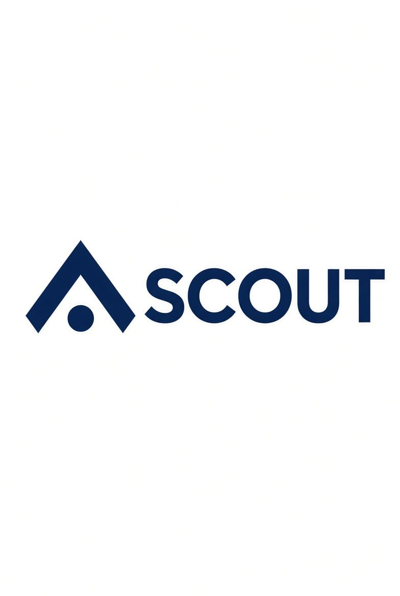
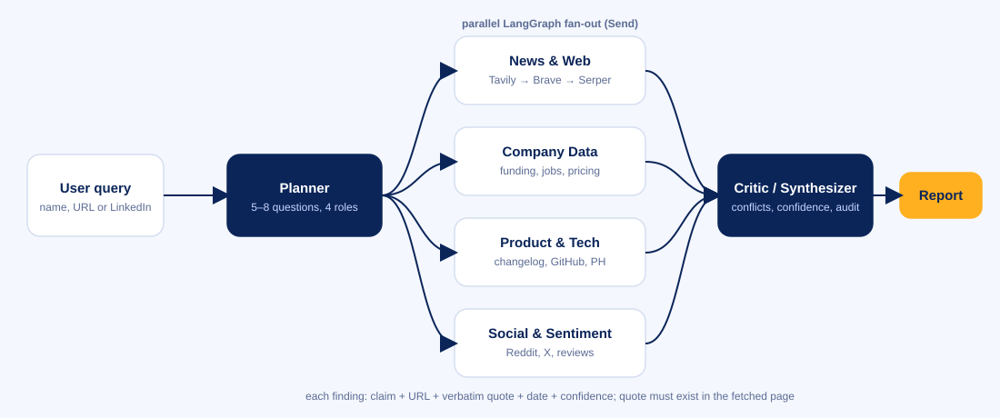

<p align="center"></p>

# Scout: competitive intelligence agent

Give Scout a company. It plans an investigation, runs four specialist researchers in parallel, and a critic checks every claim against its source before writing a cited report: executive summary, timeline of recent moves, inferred strategy, SWOT, competitor landscape, and a list of places where the evidence disagrees.

Built for the **Open Agent Hackathon 2026** (GenAI.works), Autonomous Intelligence track.



## What makes it different from "chatbot + search"

* **Verified quotes.** The model can only cite text we actually retrieved. A finding whose quote is not in the source is dropped.
* **Conflicts are shown, not smoothed over.** Different funding amounts, dates or claims land on a Conflicts tab with an assessment.
* **Evidence audit.** The report says how many claims were rejected or removed for lack of support.
* **Graceful failure.** Provider fallbacks, circuit breakers, call budgets, and a report that says "not enough evidence" instead of guessing.

## Quick start

```bash
python -m venv .venv && source .venv/bin/activate      # Windows: .venv\Scripts\activate
pip install -r requirements.txt
cp .env.example .env                                   # add keys (see below)
streamlit run app.py
```

No keys yet? Choose **Offline demo** in the sidebar. It replays a **synthetic** investigation of a fictional company so you can see the full flow, including a deliberate $15M vs $18M funding conflict.

### Keys

| Need | Provider | Where |
|---|---|---|
| LLM (one of) | Anthropic or OpenAI | `ANTHROPIC_API_KEY`, `OPENAI_API_KEY` |
| Search (one or more) | Tavily (primary), Brave, Serper | `TAVILY_API_KEY`, `BRAVE_API_KEY`, `SERPER_API_KEY` |

Model names are configurable (`SCOUT_MODEL`, `SCOUT_FAST_MODEL`, `SCOUT_OPENAI_MODEL`). Check your provider's current model IDs before the build window.

### CLI

```bash
python -m scout "Stripe" --depth quick --out stripe.md
python -m scout --demo
```

## Tests and evals

```bash
pytest -q                                  # 12 tests, no keys needed
python -m evals.run_evals --demo           # harness check
python -m evals.run_evals --depth quick    # live: 10 cases incl. a negative control -> evals/results.md
```

Add real results to `docs/FAILURE_MODES.md` before you submit; the bonus points are for documented failures.

## Deploy (public URL for judges)

1. Push to a public GitHub repo (`.env` is git-ignored).
2. Streamlit Community Cloud → New app → pick the repo → main file `app.py`.
3. Add the keys under *Settings → Secrets* as TOML: `ANTHROPIC_API_KEY = "..."` etc.
4. Open the URL from a phone on mobile data before you submit.

## Project layout

```
app.py                  Streamlit UI
scout/graph.py          LangGraph: Planner -> parallel Researchers -> Critic
scout/agents/           planner, researchers, critic, prompts
scout/search.py         Tavily/Brave/Serper with fallback + rate limits
scout/llm.py            Anthropic/OpenAI with fallback + budget
scout/scoring.py        quote verification + confidence
scout/demo.py           synthetic offline demo data
evals/                  10 cases + harness
tests/                  pytest suite
docs/                   architecture, failure modes, submission kit
reports/                saved runs (commit 2-3 real ones for the demo)
```

## Before the deadline (Oct 20, 23:45 UTC)

See [docs/SUBMISSION.md](docs/SUBMISSION.md) for the checklist, a 3–4 minute demo script and copy for the submission form.

## Limits

Scout reads public web snippets, so it can miss anything behind paywalls or logins. Strategy is inference from evidence, not insider knowledge. Treat reports as a strong first pass to verify, not a source of record.
