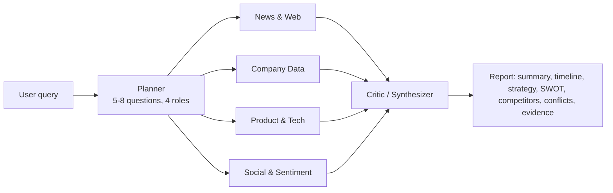

# Architecture

## Components

| Piece | File | Notes |
|---|---|---|
| Orchestration | `scout/graph.py` | LangGraph `StateGraph`. Planner fans out with `Send` to one `research` node per role; findings merge through a reducer; the Critic runs after all branches finish. |
| Planner | `scout/agents/planner.py` | LLM plan with validation. If the plan is malformed it falls back to a deterministic template that still covers all four roles. |
| Researchers | `scout/agents/researchers.py` | Role-specific queries, deduplicated sources, one extraction call. The model cites a **source number**, never a URL, so it cannot invent links. |
| Citation check | `scout/scoring.py` | A finding survives only if its quote is verbatim (or near-verbatim with a contiguous 4-gram) in the retrieved text. Otherwise it is dropped. |
| Critic | `scout/agents/critic.py` | Cross-checks findings, writes the report, and re-validates every evidence ID. Items with no valid evidence are removed and counted in the audit. A rule-based detector also catches same-round funding amount mismatches. |
| Search | `scout/search.py` | Tavily → Brave → Serper, per-provider circuit breaker, retries, rate limiting, cache, hard call budget. |
| LLM | `scout/llm.py` | Anthropic primary, OpenAI fallback, JSON repair, retries, hard call budget. |
| Runner | `scout/runner.py` | Runs the graph in a worker thread and streams events to the UI. Saves each report to `reports/`. |
| UI | `app.py`, `scout/ui.py` | Streamlit. Live pipeline, tabs, `
` citations, confidence badges, evidence filters, Markdown/JSON export. |

## Confidence

Per finding: researcher label (high 0.85 / medium 0.60 / low 0.35), +0.05 if the quote is fully verified, −0.25 if not, small recency adjustment.
Per report item: mean of its findings, +0.04 for each additional independent domain (capped at +0.10).
Labels: ≥75% high, ≥50% medium, otherwise low.

## Failure containment

* One researcher raising an exception is caught; the run continues and the gap is reported.
* Critic LLM failure produces an evidence-only report (timeline of verified findings, no inference).
* No findings produces a report that says so and makes no claims.
* `SCOUT_MAX_LLM_CALLS` / `SCOUT_MAX_SEARCH_CALLS` stop a runaway loop.
